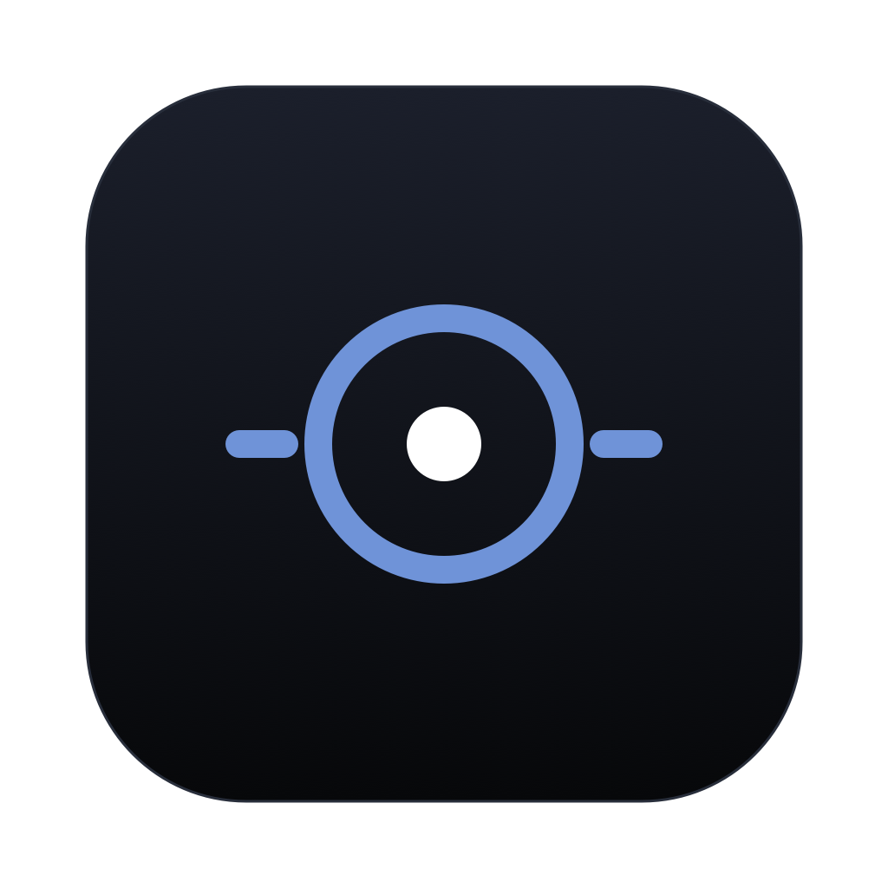

# Still Music for macOS

A small native music player for your own files, built with SwiftUI and AVFoundation.



**Early preview.** This repository publishes the macOS app. It is not a stable 1.0 release, and downloadable builds are not Developer ID signed or notarized.

## Download for Mac

[](https://github.com/bhone101/still-music/releases/download/v0.1.1/Still-Music-0.1.1-arm64.dmg)
[](https://github.com/bhone101/still-music/releases/download/v0.1.1/Still-Music-0.1.1-x86_64.dmg)

Requires **macOS 14 or later**. Choose Apple silicon for an M-series Mac, or Intel for an Intel Mac; check **Apple menu → About This Mac** if unsure. [Release notes and checksums](https://github.com/bhone101/still-music/releases/tag/v0.1.1).

Open the DMG, drag **Still Music** into **Applications**, then eject the disk image and open the app from Applications.

These preview builds are ad-hoc signed but **not Apple-notarized**, so macOS may block the first launch. If you trust the download, try opening it once, then use **System Settings → Privacy & Security → Open Anyway**. Follow [Apple's instructions](https://support.apple.com/en-us/102445); do not disable system security protections.

## What it does

- Plays local FLAC, ALAC, WAV, AIFF, MP3, AAC and CAF through macOS decoders.
- Browses songs, albums, artists, genres, composers and folders, with search and sorting.
- Includes favorites, saved playlists, an editable queue and system media controls.
- Displays local plain or synced lyrics, with optional online lookup through LRCLIB.
- Imports lyric drafts and explicitly writes or deletes embedded lyrics in FLAC, MP3 and M4A.
- Reads embedded artwork and lets you choose local covers; writing covers into FLAC files is optional.
- Supports light/dark themes, keyboard controls and source audio-quality information.

No account or analytics. Automatic online lyrics and cover writing are off by default.

## Build and run

Requires **macOS 14 or later**, Apple's Command Line Tools (or Xcode), and CMake. The build uses the host Mac's architecture; it does not produce a universal binary.

```sh
xcode-select --install
# Install CMake if needed, for example with Homebrew:
brew install cmake

bash scripts/build-app.sh
open "build/Still Music.app"
```

TagLib's source is included in `Vendor/` and built automatically. No Android SDK, Java installation, downloaded music, or external TagLib installation is needed.

The app is locally ad-hoc signed. You may move it into Applications. Public binary distribution and notarization are separate from building the source.

## Check a change

```sh
bash scripts/check.sh
```

This runs the standalone core checks using generated temporary audio and mock online services. It does not change hardware output rates. The optional hardware check is described in [development](Docs/Development.md).

## Listening and privacy

Use **Command-O** to add files/folders, **Space** to play/pause, and **Command-Left/Right** to skip tracks. Click the bottom player to expand lyrics and controls.

Audio stays in its original location. The library is stored under `~/Library/Application Support/Still/`. Removing a library entry does not delete its audio file. Lyrics/cover write actions do modify supported audio files; keep backups of music you edit.

Online lyrics sends search metadata to LRCLIB only when enabled or explicitly requested. See [privacy](PRIVACY.md) and the [user guide](Docs/UserGuide.md) for exact behavior.

## Limitations

- The quality display describes the source file, not verified DAC output. End-to-end bit-perfect output is not claimed.
- Automatic sample-rate matching can affect the shared output device; hardware-specific behavior needs testing.
- Gapless automatic transitions require compatible decoded formats. Manual skips and output-device changes can interrupt audio.
- DRM-protected downloads and Ogg/Vorbis/Opus, APE, WMA and DSD are outside the supported format list.
- The playback queue is session-only. Saved playlists and favorites persist.

## Documentation and contributions

- [User guide](Docs/UserGuide.md)
- [Development, architecture and release preparation](Docs/Development.md)
- [Audio verification and its limits](Docs/AudioVerification.md)
- [Contributing](CONTRIBUTING.md), [security reporting](SECURITY.md), and [changelog](CHANGELOG.md)

## License

Still Music's original code and repository artwork are released under the [MIT License](LICENSE).
Bundled dependencies retain their own licenses; see [third-party notices](THIRD_PARTY_NOTICES.md).
